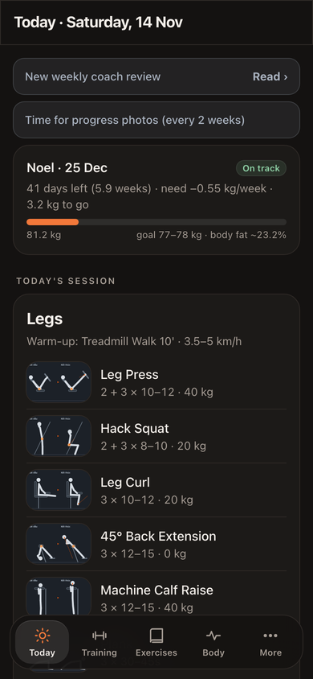
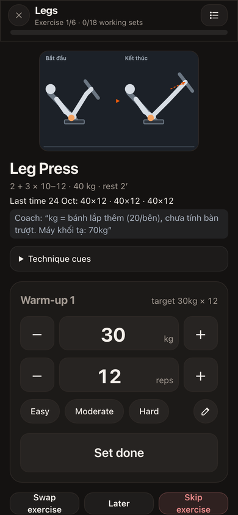
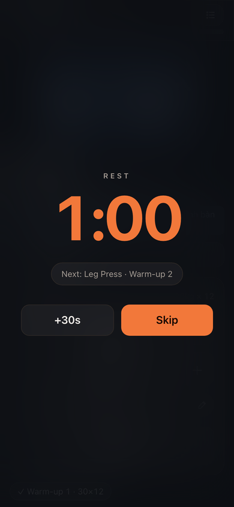
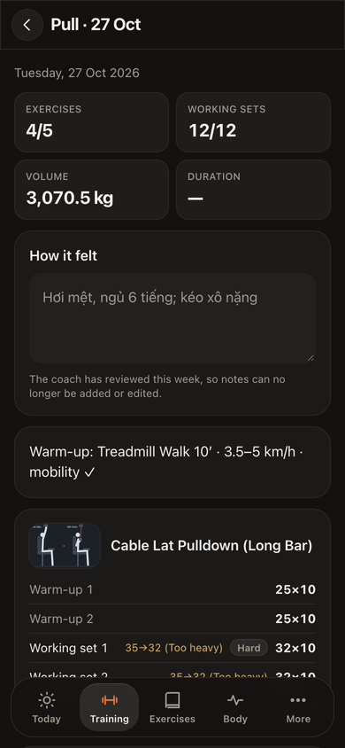
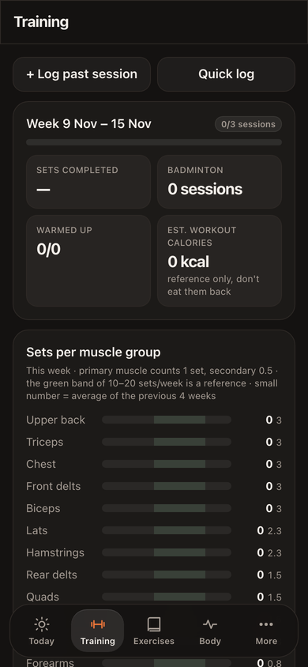
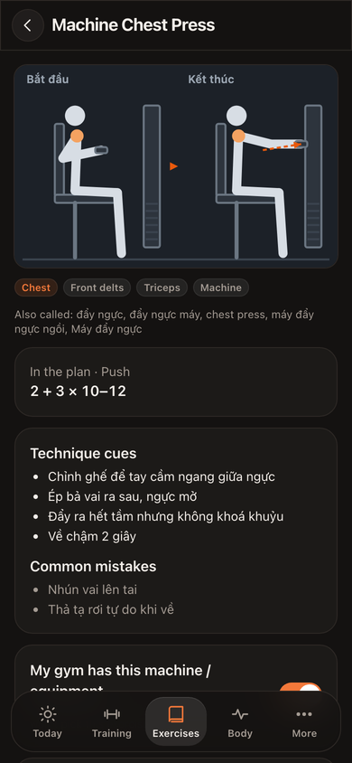
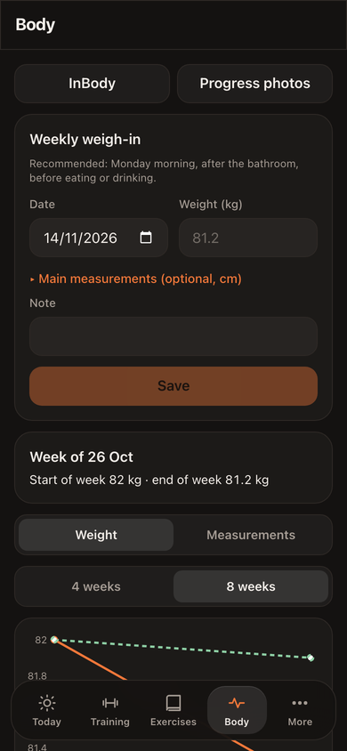
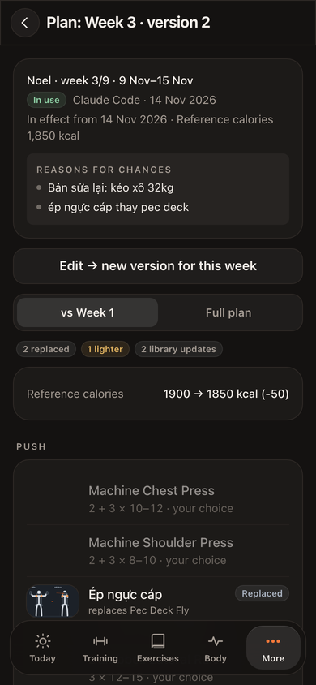
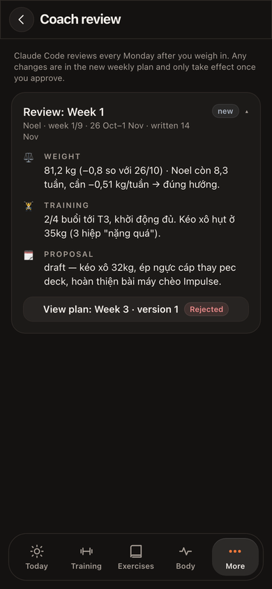

# Personal Trainee

A single-user PWA for strength training and body recomposition. It runs a fixed Push / Pull / Legs + Upper + badminton week, with a **guided workout flow** (warm-up → each exercise, each set → rest timer → summary), body weight, measurements, InBody scans and private progress photos.

Every Monday **Claude Code acts as the coach**: it reads the week through a read-only Postgres role, writes a review note and submits next week's plan as a **draft**. Nothing changes until the user approves it in the app.

Vietnamese and English UI · mobile-first · dark theme · online-only (no health data cached on the device).

<table>
  <tr>
    <td></td>
    <td></td>
    <td></td>
  </tr>
  <tr>
    <td align="center">Today: goal and session</td>
    <td align="center">Logging a set</td>
    <td align="center">Rest timer</td>
  </tr>
  <tr>
    <td></td>
    <td></td>
    <td></td>
  </tr>
  <tr>
    <td align="center">Session summary</td>
    <td align="center">Week + sets per muscle</td>
    <td align="center">Exercise library</td>
  </tr>
  <tr>
    <td></td>
    <td></td>
    <td></td>
  </tr>
  <tr>
    <td align="center">Body weight</td>
    <td align="center">Approve the coach's draft</td>
    <td align="center">Weekly coach review</td>
  </tr>
</table>

<sub>Screenshots come from the Playwright run against a local Supabase with sample seed data, with the UI set to English. Content written by the user or the coach (exercise cues, coach notes) stays in the language it was written in.</sub>

## Features

- **Guided workout**: warm-up timer and mobility checklist, per-exercise intro (SVG illustration, target, coach note), big −/+ controls, effort tap (Light / Moderate / Hard), rest timer, resume after reload, swap a busy machine or type a new one on the spot.
- **Equipment-aware loads**: kg steps or lb pin stacks (18 / 23 / 27 / 32 / 36 kg…), plates per side, assisted machines where less weight is harder.
- **Training log**: weekly view, sets per muscle, top-set and volume trends, personal records. Quick log from free text ("3 set x 12 40kg"), backfill and swapping sessions on any day.
- **Body**: weight trend against the goal line, measurements and WHR, InBody scans, progress photos (EXIF stripped, private bucket, short-lived signed URLs).
- **Goals**: dated milestones with the required weekly rate. Loss faster than 0.7 kg/week gets flagged.
- **Coach loop**: a weekly report → plan draft with reasons → a diff screen to approve or reject → the review note shows in the app.
- **Reminders**: Web Push for weigh-in, measurements, progress photos, InBody, workout, missed workout, weekly review and goal milestones, sent by an Edge Function on pg_cron.
- **Two languages**: Vietnamese (default) and English, switched under More → Language. Dates and numbers follow the language.
- **Safety**: PIN lock on open, one account (sign-up disabled), hard rules enforced in the DB and the app: reference calories ≥ 1,700, Legs never next to badminton, no Legs on Sunday.

## Quality

Measured on 14/11/2026 at commit time.

| Check | Result |
|---|---|
| Unit tests (Vitest: engine, i18n coverage) | **113 / 113** passing |
| Database tests (pgTAP: bootstrap, constraints, RLS, coach role) | **55 / 55** passing |
| End-to-end (Playwright, local Supabase) | **13 / 13** scenarios passing, 47 screens covered + English screenshots |
| Lighthouse mobile: Performance / Accessibility / Best Practices | **95 / 100 / 100** |
| Core Web Vitals (Lighthouse, simulated slow 4G) | LCP 2.5 s · TBT 0 ms · CLS 0 |
| Initial JS + CSS (gzip) | 223 KB |

Lighthouse was run on the sign-in screen of a production build (`vite preview`), since everything else sits behind auth.

## Stack

React 19 + Vite 8 + `vite-plugin-pwa` · TanStack Query · Tailwind CSS v4 · Recharts · Supabase (Auth, Postgres + RLS, Storage, Edge Functions, pg_cron, Vault) · Vitest · Playwright · pgTAP. Hosted on Vercel.

## Getting started

Requirements: Node 22+, pnpm, `psql`. For tests: Docker and the Supabase CLI.

### Local (everything on your machine)

```bash
pnpm install
supabase start             # local Postgres, Auth, Storage, Edge runtime
supabase db reset          # apply supabase/migrations/* (incl. sample seed)
pnpm run dev               # http://127.0.0.1:5173
```

Point `.env.local` at the local stack (`supabase status` prints the URL and anon key). Create a user in Studio (http://127.0.0.1:54323); sign-up is disabled on purpose.

### Hosted Supabase + Vercel

1. Create a Supabase project, then apply migrations in order: `DB_URL='postgresql://…' pnpm run db:migrate` (add `--dry-run` to preview). `app_meta.schema_version` is the watermark, so only newer files run.
2. Create the user in the dashboard (Auth → Users). Seed data (sample profile, goals, exercise library, plan v1) is created on first sign-in.
3. Edge Functions: `pnpm run functions:bundle` gives one file per function in `dist/functions/` to paste into the dashboard editor. Set the secrets from `supabase/functions/.env.example`: `APP_PIN`, `VAPID_PUBLIC_KEY`, `VAPID_PRIVATE_KEY`, `VAPID_SUBJECT`, `CRON_SECRET`.
4. Reminders: store `CRON_SECRET` in Vault as `cron_secret` and the functions base URL in `app_meta` (`functions_url`). Until both are set the cron job does nothing.
5. Frontend: deploy to Vercel with `VITE_SUPABASE_URL`, `VITE_SUPABASE_ANON_KEY`, `VITE_VAPID_PUBLIC_KEY` (see `.env.example`; only public values go in `VITE_*`).

### Commands

```bash
pnpm run typecheck && pnpm run lint && pnpm test   # before every commit
pnpm run db:test                                  # pgTAP (local stack)
pnpm run e2e                                      # Playwright against the local stack only
pnpm run seed:build                               # after editing scripts/seed/* or supabase/seed/*
pnpm run svg:build && pnpm run seed:build         # after editing scripts/svg/poses.ts
```

## The coach (Claude Code)

`coach/` is a small workspace Claude Code opens every Monday. Its instructions are in [`coach/CLAUDE.md`](coach/CLAUDE.md). The user's own profile and one-off notes go in `coach/CLAUDE.local.md` (gitignored).

- **Reads** only through the `coach_readonly` Postgres role (SELECT on a fixed set of tables, no photos, no PIN). Set its password once with `alter role coach_readonly login password '…'`. The scripts take the connection string from `COACH_DATABASE_URL` or the macOS Keychain entry `pt-coach-db`, never from a file.
- **Writes** only two things through `security definer` RPCs: a plan draft (`pnpm run submit-draft`) and a review note (`pnpm run add-review-note`). Drafts are validated (load ladders, rule checks) before they reach the app.
- `pnpm run report` produces the weekly JSON report. Reports stay local in `coach/reports/` (gitignored).

## Project structure

```
src/
  engine/        pure TypeScript, unit-tested: schedule, goals, warm-up, workout flow, loads,
                 progression, plan diff, quick-log parser, weight, InBody, reminders
  data/          Supabase reads/writes + TanStack Query hooks (memory cache only)
  auth/          sign-in, PIN lock, forced update
  app/           screens: today/ workout/ training/ exercises/ body/ more/
  ui/            shared components, icons, charts
  export/        JSON backup (pt-backup/1)
  sw.ts          service worker: precached static assets + Web Push, no data caching
supabase/
  migrations/    schema, RLS, storage, RPCs, generated seed, coach role, cron (additive only)
  functions/     verify-pin, send-reminders
  seed/          53 exercises (JSON + SVG), one backfilled sample session
  tests/         pgTAP
scripts/         seed builder, SVG illustration generator, icons, migration runner, e2e runner
coach/           Claude Code instructions + report / draft / review-note scripts
e2e/             Playwright
```

## Privacy principles

- Health data lives only in Supabase. No analytics, no third-party fonts or CDNs, nothing cached on the device.
- Progress photos stay in a private bucket, resized to 1080 px with EXIF stripped before upload, shown through 60-second signed URLs, and never sent to the coach or included in the default backup.
- Plans are immutable once approved; every change is a new version. The coach can only propose.
- The seed profile, goals and InBody in this repo are sample values.

## License

[MIT](LICENSE)
